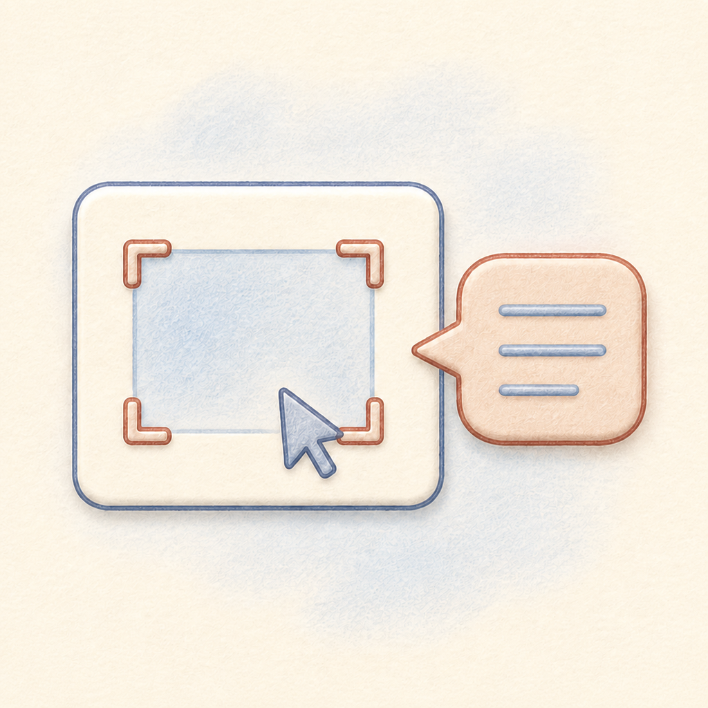
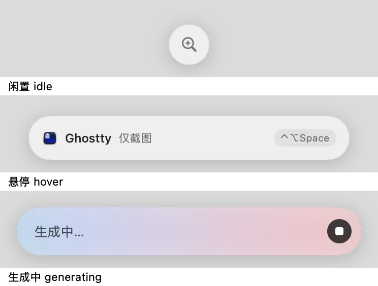

<p align="center">


  
</p>

<h1 align="center">Wisp</h1>

<p align="center">
  <strong>A native macOS AI assistant that reads your current screen and browser context when you ask.</strong>
</p>

<p align="center">
  <a href="https://github.com/ycl-2004/Wisp/releases/latest"></a>
  <a href="https://github.com/ycl-2004/Wisp/releases"></a>
  
  
  
  <a href="LICENSE"></a>
</p>

<p align="center">
  <a href="https://github.com/ycl-2004/Wisp/releases/latest/download/Wisp-macOS-universal.zip"><strong>⬇ Download for macOS</strong></a>
  ·
  <a href="https://github.com/ycl-2004/Wisp/releases">Releases</a>
  ·
  <a href="#features">Features</a>
  ·
  <a href="#privacy">Privacy</a>
  ·
  <a href="#build-from-source">Build from source</a>
  ·
  <a href="README.zh-CN.md">简体中文</a>
</p>

Wisp lives in the menu bar. Press `⌃⌥Space`, and it remembers the frontmost
app before its panel appears. It can then capture the current window (or, if
you choose, the whole screen) and, when the frontmost app is a supported browser, read the URL, title, selected text,
and page body. Ask a question without copying context between apps.

It is a local-first desktop shell around the model provider you choose:
OpenAI-compatible HTTP, Ollama, or Agent CLI (Codex, Antigravity, and Claude Code).
Conversation text and page-text snapshots are stored on your Mac; local CLIs
may place the current screenshot in a private, per-request temporary directory
that Wisp removes when the command ends. The interface ships in English and
Simplified Chinese and follows your system language.

> **Current distribution status:** the latest release is
> `v0.5.0 (build 7)`, a Universal 2 build with `arm64` and `x86_64` slices.
> Releases are ad-hoc signed and
> not Apple-notarized, so the first launch may require Control-click →
> **Open**.

> **What gets sent:** when you use a cloud provider, the full text of the page
> you are looking at and a screenshot of the current window (or the whole screen,
> if you choose Entire screen) go to the endpoint you configured. Exclusions are per application, not per site — see
> [PRIVACY.md](PRIVACY.md).

## Live captions

Turn on captions (the captions button in the panel header, `⌃⌥R` by default, or the menu
bar) during a meeting and the other side's words appear as two lines under the panel
header, updating as they speak. Captions listen to everything this Mac plays (the meeting,
a video, music), never your microphone. There is no app to choose.

When someone asks you something, press a key:

- **Quick Ask** (`⌃⌥A`): their last 10 seconds of words, no screenshot.
- **Ask About Screen** (`⌃⌥D`): their last 30 seconds plus a screenshot, for "how does this
  part of the code work?".

The answer starts with one or two sentences you can say out loud, then at most three points.
Both are ordinary commands (Settings → Commands): each can attach 0–30 seconds of captions,
with or without a screenshot, on any key. **Answer automatically (experimental)** in
Settings → Audio runs Quick Ask by itself when the other side ends a sentence with a
question mark and pauses for a second. Wisp leaves your draft in the input box.

Captions keep the last 30 seconds in memory. Caption
questions and answers live in a conversation that is never written to disk and is cleared
when captions stop. Closing the panel stops captions.

**Recognition** (Settings → Audio): Apple's on-device recognizer (default; free, the audio
stays on the Mac) or Soniox's real-time service (your own API key, about US$0.12 per hour,
and the other side's voice is sent to Soniox; usually better with English terms in Chinese
speech). Measured with Apple's recognizer on synthetic Mandarin with English terms played
through QuickTime: a sentence's caption settles 0.35–1.2 s after it ends. Caption questions
go to the API connection from Settings → Model by default, even when the panel uses an Agent
CLI. [Details and measurements](docs/live-listening.md).

**Hold to ask** (Settings → Audio, unassigned by default): hold the shortcut, say your
question, release. Wisp sends the recognized text with the current screen context and
discards the audio. In a regular conversation, the text is saved in chat history.

If the menu-bar icon is missing, reopen Wisp from Finder or Spotlight to reveal the
panel; its gear always opens Settings. Settings → Privacy controls intentional
hiding. System removal no longer changes that preference: Wisp retries insertion
once, then shows the panel if removal repeats. Full-screen menu hiding, limited
menu-bar space and third-party menu utilities remain controlled by macOS/the utility.

## Quick start

1. **[Download `Wisp-macOS-universal.zip`](https://github.com/ycl-2004/Wisp/releases/latest/download/Wisp-macOS-universal.zip)** and unzip it.
2. Move `Wisp.app` to `~/Applications` or `/Applications`.
3. On first launch, Control-click `Wisp.app`, choose **Open**, and confirm.
   The public build is not notarized, so a regular double-click may be blocked
   by Gatekeeper.
4. Grant **Screen Recording** permission in System Settings. The first time
   Wisp reads a browser page, grant Wisp **Automation** access to that browser.
5. Open **Settings → Model**, choose a provider (changes save automatically), and
   click **Test Connection**.
6. Return to the window you want to ask about and press `⌃⌥Space`.

If Control-click → **Open** is unavailable, clear the quarantine flag:

```bash
xattr -dr com.apple.quarantine "$HOME/Applications/Wisp.app"
open "$HOME/Applications/Wisp.app"
```

### System requirements

- macOS 26.0 or later.
- An Apple Silicon or Intel Mac. The published app is a Universal 2 binary.
- **Screen Recording** permission for current-window or entire-screen screenshots.
- **Automation** permission and the browser's `Allow JavaScript from Apple
  Events` setting for full-page browser text.
- Network access and your own API key for cloud endpoints.
- A running Ollama service for the Ollama provider.
- A locally installed and authenticated Codex CLI, Antigravity CLI or Claude Code for the Agent CLI provider.

## Why Wisp

- **Context is captured before the panel opens.** Wisp records the target app
  first, so the assistant panel does not accidentally become the subject of
  its own screenshot.
- **The request boundary is visible.** The header shows the current app,
  browser information, screenshot and page-text status, and conversation count.
- **Capture is on demand.** The always-available island tracks the current app
  but does not continuously record the screen or run browser scripts.
- **The model connection is yours.** Use a cloud-compatible endpoint, a local
  Ollama model, or your existing Agent CLI login through Codex, Antigravity, or Claude
  Code.
- **Conversation retention is explicit.** Conversation and turn limits are
  configurable, and deletion is initiated by the user rather than hidden
  automatic cleanup.

## Features

**Screen and browser context**

- Capture the current frontmost application's window; screenshots are normally
  kept in memory only.
- Or capture the entire display that window is on, to ask about several windows
  at once. Excluded apps, and any running apps you check, are cut out of it.
- Supports Chrome, Brave, Edge, Vivaldi, Yandex Browser, Opera, Safari, Arc,
  and selected stable or beta bundle identifiers.
- Read the current URL, page title, selected text, and page body from supported
  browsers.
- Report cross-origin iframe URLs and unavailable body text so the model does
  not assume that a page was fully read.
- Fall back explicitly to URL and screenshot context when JavaScript is
  disabled or the current app is not supported.
- The page is read once, without scrolling it, and nothing is left behind in it;
  Wisp reads Chromium preferences to check the Apple-Events setting but does not
  write Wisp data into the browser profile.

**Floating panel and island**

- A menu-bar app with no regular Dock window.
- Starts as a compact card and expands upward when needed; the conversation
  area scrolls within a bounded height.
- Supports dragging, resizing, Escape to collapse, and automatic collapse after
  leaving the panel.
- Optional launch at login, so the island is there after a restart.
- The persistent island shows the current app and context status. In its
  desktop form you can drag it anywhere on screen — it collapses to its small
  circle while you drag, so edges stay reachable — and it stays there across
  launches. Expanding follows the space available, growing inward from either
  edge instead of always from the middle. It can also snap to the Mac's camera
  notch.

**Sharing the entire screen in a meeting**

In **Settings → Privacy**, turn on **Hide Wisp from Sharing/Recording**. If the switch is already on, click **Start Presentation Display**. Wait for the prompt to share, then choose **Entire Screen → Wisp Presentation** in your meeting. Work on your main display as usual. Stop sharing in the meeting before disconnecting the presentation display.

The 1080p extended display shows regular application windows from your main display. Wisp filters out its own process before drawing frames there. The source menu bar, Dock, wallpaper and audio are omitted. New regular apps can take a couple of seconds to appear. This requires Screen Recording permission and a macOS version that supports the optional virtual display interface. Sharing your physical display uses the legacy window-hiding behavior below. [Local receiver test results](docs/evidence/presentation-display-20261118.json).

**Screen-sharing visibility (best effort)**

- The [macOS privacy research and expanded capture matrix](docs/screen-privacy-research-20260910.md)
  covers independent-process capture, live filter changes, native video recording,
  and alternatives such as protected video layers and a separate filtered share window.
  Information popovers and the notices sheet apply the hiding preference when
  their content attaches to a window. This reduces a timing gap, not the OS-level limits below.
- Enabled by default, this setting requests window hiding through
  `NSWindow.sharingType = .none`, while leaving Wisp usable on your own screen.
  Apple treats this as a legacy mechanism and explicitly says not to rely on it
  to prevent capture. Results depend on macOS and the recorder's capture path;
  the switch being on is not proof that the receiving side cannot see Wisp.
- Toggle **Hide from Capture** in the menu bar, or use
  Settings → Privacy. Turn it off to record Wisp demos.
- Local tests on macOS 26.6.1 hid synthetic windows using Wisp's production
  hiding code from ScreenCaptureKit display screenshots and video frames.
  Those same windows remained in ScreenCaptureKit's window list. This is not
  a compatibility claim for Chrome, Zoom, Meet, Teams, OBS, or a proctoring
  platform. See the [test scope, results, and reproduction steps](docs/screen-privacy-validation.md).
- Menu bar icons and system-owned dialogs are not guaranteed hidden. This
  setting does not conceal application identity, focus changes, clipboard
  events, or third-party activity records. Cameras and hardware capture are
  unaffected. Verify the actual receiving-side view before relying on it.
- **Resize guide.** A thin pale-blue rounded line and small edge markers inside the panel show
  where the custom resize gesture can start. They are visual hints only; the panel remains
  clickable. The top edge moves the panel; the sides, bottom and bottom corners resize it.

**Shortcuts**

- The default `⌃⌥Space` shortcut remains available and can be changed in
  Settings → Panel. Enhanced mode can record `Shift`, `Globe/Fn`,
  modifier-only shortcuts, and double- or triple-tap sequences. Enhanced mode
  needs Accessibility permission to observe keys while another app is active.
- Available in English and Simplified Chinese. It follows the system language,
  and Settings → General can pin either language on its own.

**Model providers**

- **Cloud endpoint:** sends `chat/completions` requests with SSE streaming and
  `image_url` data URLs, supporting OpenAI, OpenRouter, and other compatible
  endpoints.
- **Ollama:** defaults to `http://localhost:11434/v1`, reads the model list
  from Ollama, and marks models that appear to support vision.
- **Agent CLI:** the settings section contains Codex, Antigravity and Claude Code.
  Codex runs `codex app-server --listen stdio://` with an ephemeral, read-only
  thread; Antigravity and Claude Code use headless `stream-json`. All three
  display answer text as it arrives, with screenshots passed through a private
  temporary workspace. None of them writes session files
  into Wisp's conversation directory.
  See [CLI streaming and validation](docs/cli-streaming.md) for protocol details.
  Fast is preferred for supported Codex models and supported Claude Opus
  selections, with standard-speed fallback. AGY 1.1.27 has no Fast switch.
  Fast can consume more credits; it does not lower reasoning effort or change
  your selected model.
  Cloud requests also prefer Fast/Priority on OpenRouter paid models and the
  official OpenAI and Gemini endpoints. OpenRouter free models keep their free
  IDs and prefer throughput; unsupported gateways receive no extra parameters.
  Availability and billing depend on the service. See [speed preferences](docs/model-speed.md).
- **Quick / Deep responses:** select a mode above the input (Quick is the default); set
  each mode's model and shortcut in Settings → Model. Choices remain editable during an
  answer and apply to the next question. Quick skips new full-page text capture and sends
  the default model; Deep uses more supported reasoning, and on Antigravity switches to the
  default model's High thinking level. Both prefer available Fast tiers. A Quick answer can
  be redone in Deep with one click, replacing it without using another turn. The stopwatch
  separates preparation, first-text and total latency; higher effort alone does not establish accuracy.
- **Commands:** saved questions such as Summarize This Page or Translate Selection, each
  with its own mode and optional shortcut, run from the ✦ menu, the empty chat, or any app.
  Text in the input box goes with the command as its material. Edit them in Settings → Commands.

**Startup and updates**

- Optional launch at login through `SMAppService`, with a direct link to Login
  Items & Extensions when macOS holds the item for approval.
- Optional update check that asks GitHub once per launch for the latest release
  tag. It is off by default, sends nothing about you or your usage, never
  installs anything on its own, and can be switched off entirely.

**Local conversations**

- Keeps up to 10 conversations by default, with up to 30 user turns per
  conversation; both limits can be changed in Settings.
- Preserves the latest two turns in full and folds older context into summary
  rows.
- Limits page text to 60,000 characters, retaining the first 75% and last 25%
  when the page is longer.
- Stores conversations as readable JSON, decoded tolerantly so that a damaged
  record or a field added by a future version costs you that record rather than
  the whole history.
- Refuses to overwrite a conversation file written by a newer version of Wisp,
  and tells you when a file could not be read instead of quietly starting empty.
- At the conversation limit, offers to drop the least recently updated
  conversation by name rather than simply refusing to create a new one.
- Settings can delete all conversations and the saved API key.

## Usage

### Ask one question

```text
⌃⌥Space
  ↓ remember the current frontmost app
  ↓ capture the window; read browser URL, title, and page text when available
  ↓ show the panel and label the captured context
  ↓ ask a question → send it to the selected provider
  ↓ keep the conversation locally after the answer completes
```

### Shortcuts and controls

| Action | Default behavior |
| --- | --- |
| `⌃⌥Space` | Show or collapse the panel; configurable in Settings → Panel |
| `Return` or `⌘↩` | Send (`⇧↩` inserts a newline) |
| `⌘.` | Stop generation |
| `Esc` | Collapse the panel |
| Header `∧` / `∨` | Switch between compact card and expanded panel |
| Island right-click → **Refresh Context** | Refresh the current screen and page context |
| Camera button | Include or exclude the screenshot from this request |
| `!` button (when shown) | Show blocking capture details, such as a missing permission or browser JS setting |
| Speech-bubble button | Open the conversation list |

Wisp captures context when the panel is shown without a current shot or after
the frontmost app changed, when you choose **Refresh Context** from the island's
shortcut menu, and before sending if Deep mode still needs full-page text or you
switched apps after leaving the panel. It does not automatically recapture while
a response is generating.

### Choose a provider

Open the menu-bar icon → **Settings → Model**:

- **Cloud endpoint:** pick a provider — OpenRouter, Google Gemini, OpenAI,
  Anthropic, Zhipu GLM, or *Custom* for any other OpenAI-compatible address —
  then pick a model and enter that provider's API key. Choosing a provider
  fills in the Base URL and its model list for you. Keys are saved on blur,
  Return, provider switch, or closing Settings, one per provider, in the macOS
  Keychain rather than the conversation JSON, so several providers stay
  configured side by side and switching never loses one.
- **Ollama:** start Ollama and refresh the model list. Only a vision-capable
  model can interpret a screenshot.
- **Agent CLI:** choose Codex, Antigravity, or Claude Code inside the same section,
  select the detected executable and optionally choose a model. Wisp uses the
  CLI login already on your Mac. Antigravity models are refreshed by running
  `agy models`, so an Antigravity update does not require a Wisp update.

All three provider groups have **Test Connection**. Cloud and Ollama tests send a
very small test image to each model Quick and Deep use. Codex and Antigravity tests check `--version`;
Claude Code uses `auth status` so a missing login gets its own message. None of
the local CLI checks spends a model request.

## Screenshots

These images were generated by the current build's offline rendering entry
points. They contain no real desktop, conversation, or personal files. The
header image uses simulated Chrome page metadata; the SwiftUI `Menu` model
selector was cropped because it is not rendered by the offline ImageRenderer.

<table>
  <tr>
    <td align="center"><strong>Context header</strong><br></td>
  </tr>
  <tr>
    <td align="center"><strong>Persistent island: idle, hover, and generating states</strong><br></td>
  </tr>
</table>

To regenerate the checked-in images, build with the diagnostics flag — the
rendering entry points require both `DEBUG` and an explicit
`WISP_DIAGNOSTICS`, so that neither a shipped app nor an ordinary Debug build
can be driven by another local process:

```bash
xcodebuild -project Wisp.xcodeproj -scheme Wisp -configuration Debug \
  SWIFT_ACTIVE_COMPILATION_CONDITIONS="DEBUG WISP_DIAGNOSTICS" build

Build/Debug/Wisp.app/Contents/MacOS/Wisp --render-header docs/screenshots/context-header.png
Build/Debug/Wisp.app/Contents/MacOS/Wisp --render-island docs/screenshots/island-states.png
```

Add `-AppleLanguages '(en)'` or `-AppleLanguages '(zh-Hans)'` to render a
specific localization.

## Privacy

**Local storage**

- Conversation text and page-text snapshots:
  `~/Library/Application Support/Wisp/conversations.json`.
- API keys: stored in the macOS Keychain, outside Wisp's support directory.
- Screenshots: never written to the conversation JSON. Cloud and Ollama keep
  them in memory; local CLIs may write them to a private per-request temporary
  directory and remove it when the command ends. A crash can defer cleanup to
  macOS's temporary-directory maintenance.
- Optional debug files: when debug capture is enabled, Wisp writes
  `debug/last-context.json` and `debug/last-screenshot.jpg` under its
  application-support directory.

**Network boundary**

- The OpenAI-compatible provider sends the context you selected and the
  current screenshot to the Base URL you configured. The service's logs,
  retention, and privacy policy are outside Wisp's control.
- Ollama uses `localhost` by default. If you configure a remote Base URL, the
  request goes to that address.
- Wisp starts a local Codex app-server, creates a temporary directory for image
  input, uses an ephemeral thread and a read-only sandbox, and removes the
  temporary directory when the command ends. Codex's own account, network,
  and service-side logging are outside Wisp's control. The read-only sandbox
  stops commands Codex runs from writing or using the network, but not from
  reading: Codex can read any file your account can, and a captured page could
  try to talk it into it. See [PRIVACY.md](PRIVACY.md#what-leaves-your-mac) for the
  comparison with Claude Code's restricted mode.
- Wisp starts Antigravity locally, in its own temporary working directory, with
  `--sandbox` and Antigravity's JSON headless mode. An attached screenshot is written
  into that directory and named in the prompt so Antigravity reads it from disk; the
  directory is removed when the request ends. Antigravity's account, network, quota,
  and service-side logging remain outside Wisp's control.
- Wisp starts Claude Code in its own temporary working directory with
  `--restricted --tools Read --no-session-persistence`. Only the screenshot
  files placed in that workspace are available to its file tool; Wisp removes
  the directory when the command ends. Claude Code's account, network, quota,
  and service-side logging remain outside Wisp's control.
- If the update check is enabled, Wisp asks `api.github.com` once per launch
  for the latest release tag. The request carries no identifier beyond your IP
  address and a `Wisp/<version>` user agent, downloads nothing, and installs
  nothing. Turning it off makes no request at all.
- Wisp has no account system, sync service, analytics SDK, crash-reporting SDK,
  or automatic background recording. Live captions listen to what this Mac plays only while
  they are on, and nothing they hear is saved; see [details](docs/live-listening.md).

**Exclusions are per app, not per site.** The exclusion list takes bundle
identifiers, so there is currently no way to exempt one URL or domain while
still using Wisp in that browser. Entire-screen captures always cut out excluded
apps, plus any apps you check under Settings → Capture → Capture range.

The full policy is in [PRIVACY.md](PRIVACY.md).

**Permissions**

- **Screen Recording:** current-window or entire-screen screenshots, plus system-audio capture while live captions are on.
- **Microphone:** only while the **Hold to Ask** shortcut is held.
- **Automation / Apple Events:** browser URL and title access, plus page
  JavaScript execution for supported browsers.
- **Accessibility:** only for the enhanced shortcut mode, to observe Shift,
  Globe/Fn, modifier-only, or double-/triple-tap key events while another app
  is active. The standard shortcut does not need this permission.
- **Network client:** cloud endpoints, remote Ollama, or networking performed
  by Codex itself.

## Current release

The current release is `0.5.0 (build 7)`; see
[CHANGELOG.md](CHANGELOG.md). It corresponds to Git tag `v0.5.0`.

| Artifact | Purpose |
| --- | --- |
| `Wisp-macOS-universal.zip` | macOS app containing `arm64` and `x86_64` |
| `Wisp-macOS-universal.zip.sha256` | SHA-256 checksum for the ZIP |

The Universal 2 package passed `lipo -info` checks for both architecture
slices. Release validation was performed on Apple Silicon; an Intel hardware
runtime regression has not yet been completed. The package is ad-hoc signed
and not Apple-notarized, so the first launch may require Control-click →
**Open**.

## FAQ

<details>
<summary>How do I move the island, and how do I change the app's language?</summary>

Hold and drag the island to anywhere on the desktop. While you drag it
collapses to its small circle and rides under the cursor, so you can push it
flush against a screen edge; when it expands again it grows toward whichever
side has room rather than always from the middle. It stays where you drop it,
remembers that position across launches, and is pulled back on screen if your
display arrangement changes. Settings → **Panel** → **Reset Position**
puts it back at the bottom center, and the same section can switch it
to the notch form, which stays anchored to the notch. Dragging the island never
moves the assistant panel — that still opens from the bottom center and keeps
its own position.

Wisp ships English and Simplified Chinese and follows your system language by
default. To pin one language regardless of the system setting, open
Settings → **General** → **Interface language** and pick it; Wisp offers to
restart, which is when the change takes effect. The setting affects Wisp alone
and leaves your system settings untouched.

The equivalent from a terminal, if you prefer:

```bash
defaults write com.yichenlin.Wisp AppleLanguages -array en
```

Use `zh-Hans` for Simplified Chinese, or
`defaults delete com.yichenlin.Wisp AppleLanguages` to follow the system again.
Restart Wisp afterwards.

</details>

<details>
<summary>I updated Wisp and it stopped capturing, or asked for permissions again</summary>

Releases are ad-hoc signed, which means each build has a different code
identity. macOS binds Screen Recording, Automation, and Keychain access to that
identity, so a new version can appear as a different app and lose the grants of
the old one. Re-grant Screen Recording under System Settings → Privacy &
Security, allow Automation for your browser the next time Wisp reads a page,
and re-enter the API key if the Keychain prompt is declined. Removing the stale
entry for the old build from the Screen Recording list keeps that list tidy.

This goes away once releases are signed with a Developer ID certificate and
notarized. For the copy you build and use yourself, `tools/install-local.sh` already
avoids it: it signs with your team certificate, so the code identity stops changing
between rebuilds.

</details>

<details>
<summary>macOS says Wisp cannot be opened because the developer cannot be verified</summary>

The public build is ad-hoc signed and not Apple-notarized, so Gatekeeper may
block a plain double-click. Control-click `Wisp.app`, choose **Open**, and
confirm once. If the option is unavailable, run the `xattr` command shown in
[Quick start](#quick-start).

</details>

<details>
<summary>Why does the browser show a screenshot but no full-page text?</summary>

Check that Wisp has Automation permission, that the browser profile has
`Allow JavaScript from Apple Events` enabled, and that the page is not a
browser-internal page such as `chrome://`. Chrome stores this JavaScript
setting per profile. Cross-origin iframe body text may still be unavailable,
so the screenshot remains the fallback.

</details>

<details>
<summary>Does Wisp continuously record my screen?</summary>

No. The persistent island only tracks the current app. Screenshots are taken
when the panel is shown or context is refreshed, and completed-response
screenshots are not written to Wisp's conversation file.

</details>

<details>
<summary>How do I uninstall Wisp?</summary>

Quit Wisp from the menu-bar icon, then move `Wisp.app` to the Trash. To also
remove local conversations, preferences, and debug files, run:

```bash
rm -rf "$HOME/Library/Application Support/Wisp"
defaults delete com.yichenlin.Wisp
```

Saved API keys can be cleared before uninstalling via **Settings → Data → Delete All Data & Settings**, or deleted afterwards in **Keychain Access** under `com.yichenlin.Wisp`.

</details>

## Build from source

<details>
<summary>Requirements, development commands, and Universal 2 packaging</summary>

Requirements:

- macOS 26.0 or later.
- Xcode 26 or later (KeyboardShortcuts 3.1.0 needs Swift tools 6.2); Xcode 26.6
  is the CI environment.
- [XcodeGen](https://github.com/yonaskolb/XcodeGen) 2.45.4 or later, used to
  regenerate the Xcode project from `project.yml`.
- Swift Package Manager, which resolves `KeyboardShortcuts` 3.1.0 for the
  current lock state.

Build for local development:

```bash
xcodegen generate
xcodebuild -project Wisp.xcodeproj -scheme Wisp -configuration Debug build
cp -R Build/Debug/Wisp.app "$HOME/Applications/"
```

Install the copy you actually use (`/Applications/Wisp.app`) without losing system
permissions:

```bash
tools/install-local.sh              # build, sign, install; clean temporary backup after verification
tools/install-local.sh --no-install # build and sign only
tools/install-local.sh --keep-backup # optional: retain the rollback copy
```

An ad-hoc signature has no certificate chain to anchor to, so its designated
requirement is `cdhash H"…"`. Any code change changes that hash, macOS treats the
result as a different program, and screen recording, microphone and speech
recognition must be granted again on every update. Signing with the team certificate
makes the requirement `identifier "com.yichenlin.Wisp" and anchor apple generic and
certificate leaf…`, which does not depend on the code at all. Certificates rotate
yearly and their names carry an identifier that changes, so the script picks the
certificate by team ID and signs with its fingerprint — a keychain can also hold
development certificates belonging to other accounts, and matching by name picks the
wrong one. The switch itself asks for permissions once more; rebuilds after that do not.
The installer keeps the old bundle only until the new signature and move are verified,
then removes that temporary backup by default. Use `--keep-backup` only when you need
to retain a rollback copy.

**Do not distribute that build:** other machines do not have your development
certificate, and Gatekeeper will refuse it.

If your machine does not have the development team or signing identity in the
project, use an unsigned build for compile verification:

```bash
xcodebuild -project Wisp.xcodeproj -scheme Wisp -configuration Debug \
  CODE_SIGNING_ALLOWED=NO build
```

Build the Universal 2 release package:

```bash
rm -rf Build
xcodebuild -project Wisp.xcodeproj -scheme Wisp -configuration Release \
  -arch arm64 -arch x86_64 \
  ONLY_ACTIVE_ARCH=NO \
  CODE_SIGN_IDENTITY=- CODE_SIGNING_REQUIRED=YES \
  CODE_SIGN_INJECT_BASE_ENTITLEMENTS=NO build

mkdir -p dist
lipo -info Build/Release/Wisp.app/Contents/MacOS/Wisp
ditto --norsrc -c -k --keepParent \
  Build/Release/Wisp.app \
  dist/Wisp-macOS-universal.zip
(cd dist && shasum -a 256 Wisp-macOS-universal.zip > Wisp-macOS-universal.zip.sha256)
```

`--norsrc` omits resource forks and AppleDouble `._` files. `--sequesterRsrc` is
also deliberately omitted: it stores resource forks in a `__MACOSX` folder
that users see next to the app after unzipping. The resulting archive is clean,
and the signature still verifies after a round trip.

The `lipo -info` output should list `arm64` and `x86_64`. Apple's
[Universal macOS binary documentation](https://developer.apple.com/documentation/apple-silicon/building-a-universal-macos-binary)
describes this two-architecture packaging model. Rosetta can run the
`x86_64` slice on Apple Silicon, but Intel hardware testing still needs to
be performed separately.

Release validation:

```bash
plutil -p Build/Release/Wisp.app/Contents/Info.plist
codesign --verify --deep --strict Build/Release/Wisp.app
codesign -d --entitlements :- Build/Release/Wisp.app
unzip -l dist/Wisp-macOS-universal.zip
(cd dist && shasum -a 256 -c Wisp-macOS-universal.zip.sha256)
```

The Release must not contain `com.apple.security.get-task-allow`. The repository
includes an XCTest target and a GitHub Actions workflow that runs the tests,
builds Universal 2 Release, and rejects that entitlement.

`xcodebuild test` hosts the tests inside a Debug build of the app. To run the
Foundation-only core tests without starting the app (or on Linux):

```bash
cd tools/linux-harness
./sync-sources.sh   # copy the app sources and the matching WispTests files
swift test
```

</details>

## Project layout

- `Wisp/App/` — app entry point, menu-bar lifecycle, global shortcut, and
  diagnostic entry points.
- `Wisp/Capture/` — screen capture, browser AppleScript, page text, and
  context orchestration.
- `Wisp/LLM/` — OpenAI-compatible HTTP, Ollama, Agent CLI, SSE parsing, and
  prompt assembly.
- `Wisp/Store/` — local conversation JSON and macOS Keychain access.
- `Wisp/UI/` — floating panel, persistent island, chat, context header,
  conversation list; `Wisp/UI/Settings/` holds one file per Settings tab.
- `Wisp/Support/` — permissions, screen geometry, UserDefaults settings, login
  item, and update checking.
- `Wisp/Resources/` — the string catalog.
- `WispTests/` — the only test sources: providers and stream parsing, stores,
  captions, capture scripts, and UI rendering.
- `tools/linux-harness/` — a SwiftPM package that compiles the Foundation-only part
  of the app and runs the matching subset of `WispTests` (copied in by
  `sync-sources.sh`, never edited there), on Linux or on a Mac without starting the app.
- `Wisp/Assets.xcassets/` — macOS app icon and image assets.
- `docs/screenshots/` — the current offline-rendered README screenshots.
- `docs/records/` — audit rounds, the coverage map and the onboarding design record.
- `project.yml` — XcodeGen project source, version settings, dependencies,
  localization configuration, and signing configuration.
- `LICENSE`, `THIRD-PARTY-NOTICES.txt`, `PRIVACY.md`, `CHANGELOG.md` — licence,
  bundled dependency notices, privacy policy, and release notes. The notice is
  copied from the repository root into the app bundle at build time.

## Versioning and releases

`project.yml` is the source of truth for `MARKETING_VERSION` and
`CURRENT_PROJECT_VERSION`; `Wisp.xcodeproj` is regenerated with XcodeGen.
The current release convention is:

1. Update the marketing version or build number in `project.yml`.
2. Run `xcodegen generate` and complete a Debug or Release build.
3. For a distributable build, verify both architecture slices, bundle metadata,
   signature, ZIP integrity, and checksum.
4. Create a `vX.Y.Z` Git tag and upload
   `Wisp-macOS-universal.zip` plus its `.sha256` file to the matching
   GitHub Release.

`Build/`, `dist/`, Xcode user state, diagnostics, and local environment
files are ignored by Git. Source, icon assets, project files, the package
resolution, and public documentation are tracked.

## Known limitations

- The current public package is ad-hoc signed and not Apple-notarized.
- The Universal 2 slices have been generated and checked on Apple Silicon, but
  the current release has not yet been run on an Intel Mac.
- Browser extraction depends on supported bundle identifiers, Automation
  permission, browser JavaScript settings, and page security boundaries.
- Codex streaming requires a CLI with the app-server v2 protocol (verified with
  0.153.4). Each request still carries Codex's own fixed context cost.
- Antigravity streams agent response deltas (verified with 1.1.27 and 1.5.18); older versions
  that emit only a final result display that result at completion. Each request
  carries Antigravity's own fixed context cost — previously measured at about 30,400 tokens before
  any of Wisp's content. Screenshots are passed as files because Antigravity's headless
  input accepts text only — it rejects an `image_url` content block — so a
  screenshot request spends one extra tool turn on reading the file, which costs
  about 1,150 tokens rather than inlining the image. Antigravity also truncates its own
  input at roughly 71,400 tokens without saying so, so Wisp fits the prompt to a
  smaller budget first and marks what it left out; a page far larger than the
  default 60,000-character limit therefore reaches Antigravity abridged, with the gap
  declared, rather than silently incomplete.
- CI covers unit tests, Universal 2 compilation, signature verification, and
  the Release entitlement check. There is still no public notarization and
  release-signing pipeline.
- Because releases are ad-hoc signed, every build has a new code identity.
  macOS ties Screen Recording, Automation, and Keychain access to that identity,
  so updating the app can require granting those permissions again.
- Codex's read-only sandbox does not limit reads. A page you capture could try to
  get Codex to read local files and include them in its turn; Claude Code runs in a
  restricted, Read-only workspace instead. Prefer Claude Code, a cloud endpoint or
  Ollama for pages you do not trust.
- App exclusions are per bundle identifier. There is no per-URL or per-domain
  exclusion, which is the exclusion most useful in a browser.
- Conversation history is stored as unencrypted JSON and is not evicted by age.
  Conversation and turn counts are bounded, but message bytes are not strictly
  capped; the file is rewritten in full on every message. Live captions do not
  append messages automatically.
- The island can be dragged only in its desktop form; the notch form stays
  anchored to the notch.
- The island's circle can reach a screen edge but not overlap it, so its centre
  stops one radius (20pt) inside the edge.

## Credits

Wisp bundles one third-party component:

- [KeyboardShortcuts](https://github.com/sindresorhus/KeyboardShortcuts) 3.1.0 by
  Sindre Sorhus, under the MIT License, for global shortcuts.

Their full notices ship inside the app — Settings → General → **Open-source
licenses** — and are checked in as [THIRD-PARTY-NOTICES.txt](THIRD-PARTY-NOTICES.txt).
The rest is written in SwiftUI and AppKit.

## License

Wisp is copyright © 2026 YC and available under the [MIT License](LICENSE).

## Links

- [GitHub repository](https://github.com/ycl-2004/Wisp)
- [Latest release](https://github.com/ycl-2004/Wisp/releases/latest)
- [Release assets](https://github.com/ycl-2004/Wisp/releases)
- [Issues](https://github.com/ycl-2004/Wisp/issues)
- [Release notes](CHANGELOG.md)
- [Privacy policy](PRIVACY.md)
- [Third-party notices](THIRD-PARTY-NOTICES.txt)
- [Simplified Chinese README](README.zh-CN.md)
